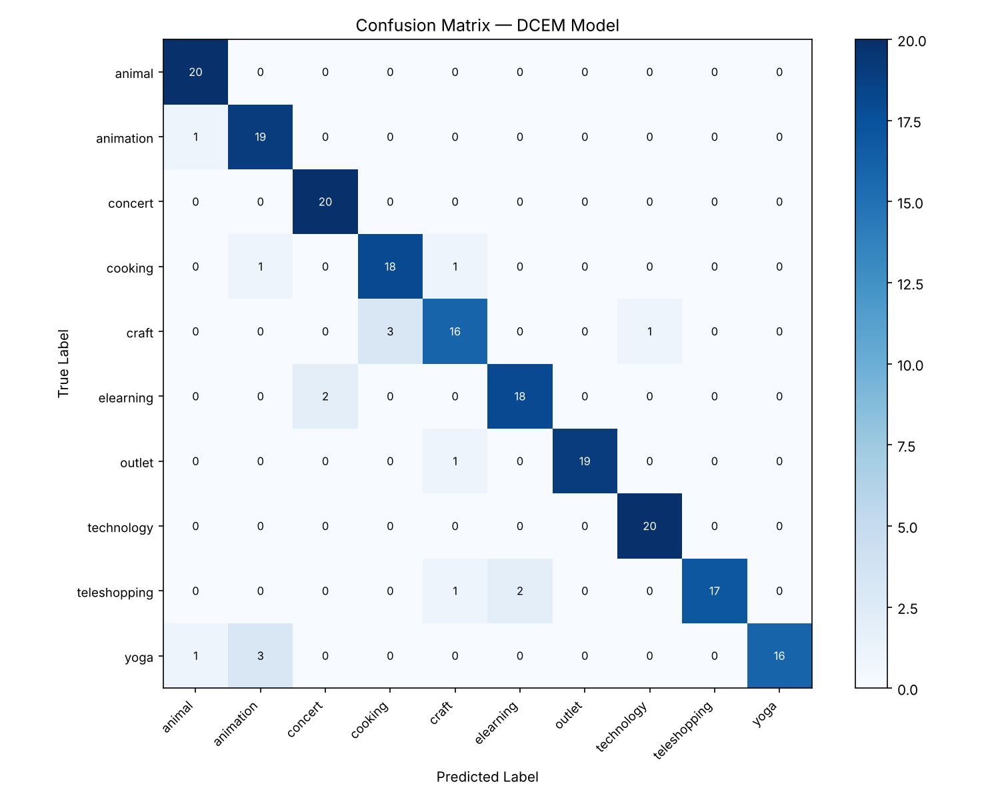
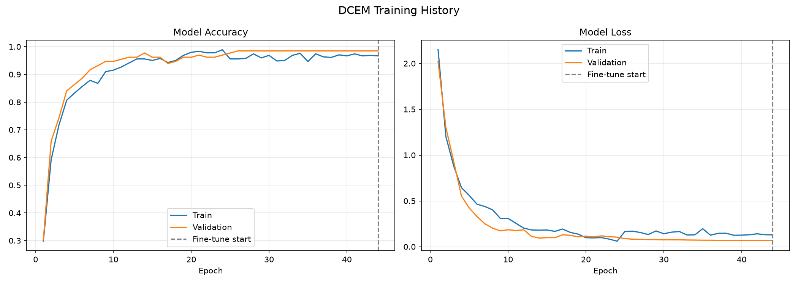
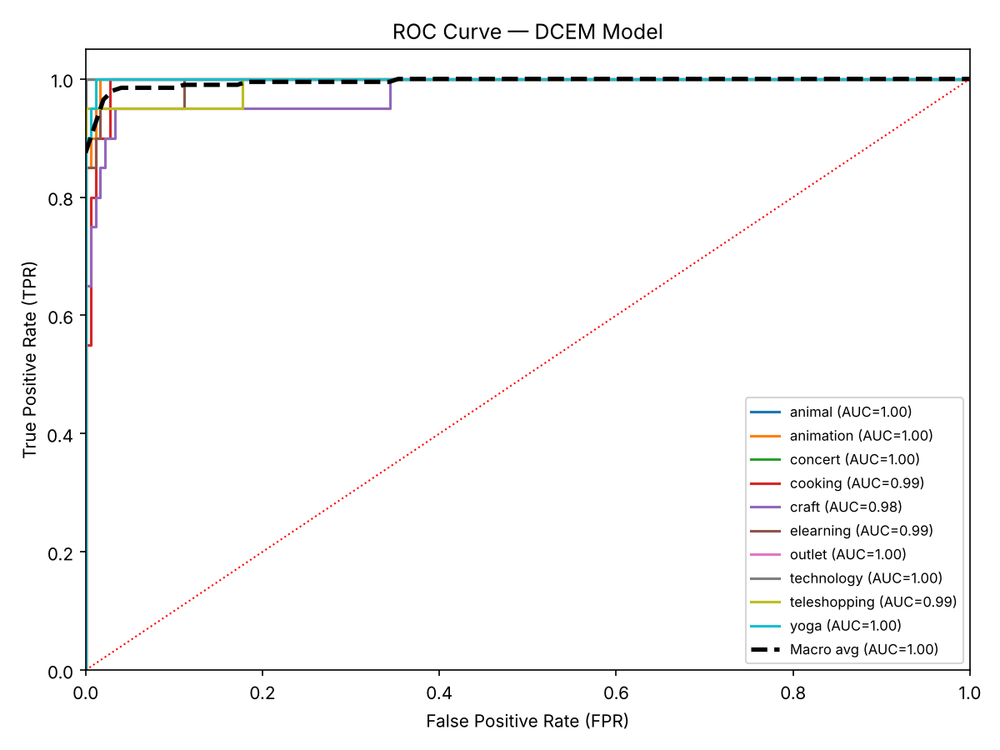

# DCEM — Deep Convolutional Encoder Model for Image Category Classification

Transfer-learning image classifier that sorts video frames and images into **10 content categories** (animal, animation, concert, cooking, craft, e-learning, outlet, technology, teleshopping, yoga). It reimplements the DCEM architecture from my IEEE ICERCS'23 co-authored paper with TensorFlow/Keras, and compares **VGG16** and **ResNet50** encoders.

| Model | Test accuracy | Macro F1 |
|---|---:|---:|
| **DCEM + ResNet50** | **91.5%** | **0.914** |
| DCEM + VGG16 | 60.0% | 0.567 |

*Held-out test set: 200 images (20 per class). Full numbers: [`results/metrics.json`](results/metrics.json).*



## How it works

```
image (224×224) ──► pre-trained encoder (VGG16 / ResNet50 / InceptionV3, ImageNet)
                 ──► bottleneck: GlobalAvgPool → Dense 512 → BatchNorm → Dropout
                 ──► classifier: Dense 256 → 128 → 64 (BatchNorm + Dropout)
                 ──► softmax over 10 classes
```

Training runs in two phases:

1. **Frozen encoder.** Only the bottleneck and classifier train (Adam, lr 1e-3), with data augmentation (rotation, shifts, flips, zoom, brightness), early stopping and learning-rate reduction.
2. **Fine-tuning.** The top 4 encoder layers are unfrozen and trained with a 100× lower learning rate (1e-5). The best checkpoint across both phases is kept.

## Results (ResNet50)

| Class | Precision | Recall | F1 |
|---|---:|---:|---:|
| animal | 0.909 | 1.000 | 0.952 |
| animation | 0.826 | 0.950 | 0.884 |
| concert | 0.909 | 1.000 | 0.952 |
| cooking | 0.857 | 0.900 | 0.878 |
| craft | 0.842 | 0.800 | 0.821 |
| elearning | 0.900 | 0.900 | 0.900 |
| outlet | 1.000 | 0.950 | 0.974 |
| technology | 0.952 | 1.000 | 0.976 |
| teleshopping | 1.000 | 0.850 | 0.919 |
| yoga | 1.000 | 0.800 | 0.889 |

The most common mistakes are **craft → cooking** (3 images) and **yoga → animation** (3 images). Both pairs look visually similar: hands working on a table, and stylised human poses.

**Why VGG16 is much weaker here:** with the same head and training budget, VGG16's features separated the classes far less well. It over-predicts *concert* and *cooking*, and recall for *teleshopping*, *e-learning* and *craft* drops below 25% ([VGG16 report](results/vgg16/classification_report.txt)). ResNet50's residual features transfer better to this small dataset.

| Training curves (ResNet50) | ROC curves (ResNet50) |
|---|---|
|  |  |

## Quick start

```sh
python3 -m venv venv && source venv/bin/activate
pip install -r requirements.txt

# 1. Build the dataset (about 80 training and 20 test images per class, from Bing image search)
python download_dataset.py

# 2. Train
python main.py --mode train --data_dir data/train --backbone resnet50 --epochs 30

# 3. Evaluate: writes the report, confusion matrix, ROC and per-class bar chart to output/
python main.py --mode evaluate --model_path output/dcem_resnet50_final.h5 --test_dir data/test

# 4. Predict one image (top-3 classes plus a probability chart)
python main.py --mode predict --model_path output/dcem_resnet50_final.h5 --image path/to/image.jpg

# Smoke test without real data (random-noise images, a few epochs)
python main.py --mode demo
```

Other backbones: `--backbone vgg16` or `--backbone inception` (InceptionV3 uses 299×299 inputs).

## Tests

```sh
pip install pytest
python -m pytest -q tests
```

The tests run offline in a few seconds. They check model shapes, encoder freezing and unfreezing, backbone detection, and that predicted indices map to the right class names.

## Project structure

```
main.py              CLI: train / evaluate / predict / predict_batch / demo
model.py             DCEM architecture (+ experimental multi-task variant)
dataset.py           Class list, data generators, augmentation, preprocessing
train.py             Two-phase training with checkpoints, early stopping, LR schedule
evaluate.py          Classification report, confusion matrix, ROC, bar chart
predict.py           Single-image and folder prediction with probability plots
download_dataset.py  Builds data/train and data/test with icrawler
results/             Evaluation output for the trained models
tests/               Offline unit tests
```

Datasets, trained weights (`*.h5`, ~120 MB each) and `output/` are not committed.

## Limitations

- **Small dataset:** 676 training and 200 test images, collected from web image search. Train and test images come from different search queries, but near-duplicates between them were not removed, so the scores may be optimistic.
- The **multi-task variant** (`--multitask`) adds a text-presence detection head. There are no text-presence labels yet, so every image gets the label 1, and that head is a placeholder until real annotations are added.
- Downloaded images belong to their original owners and are for local experimentation only. They are not included in this repository.

## Changelog

- Fixed **wrong class names in `predict.py`**. Keras numbers classes alphabetically, but predictions were mapped to the paper's class order, so most single-image predictions showed the wrong label. `CLASSES` now follows Keras' order, and a test guards this.
- `predict.py` now uses the preprocessing that matches the model's backbone.
- The fine-tuning phase can no longer overwrite a better checkpoint from phase 1.
- Added the README, evaluation results, tests, and the missing dependencies (`scipy`, `icrawler`).

## License

MIT
